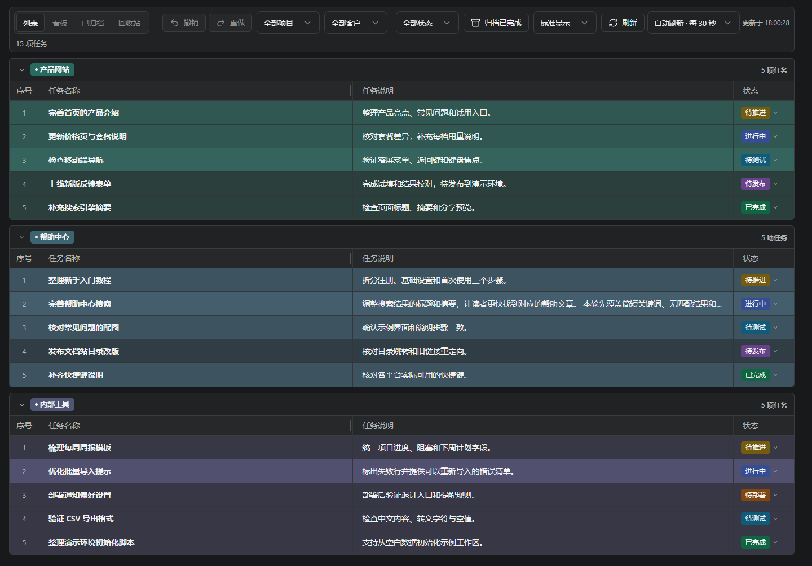
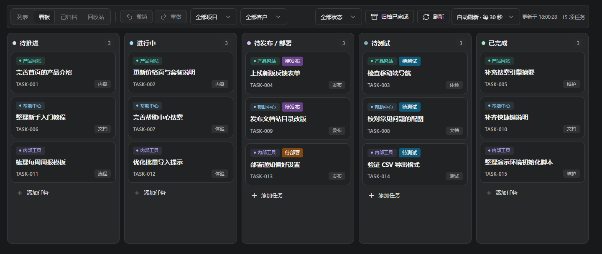
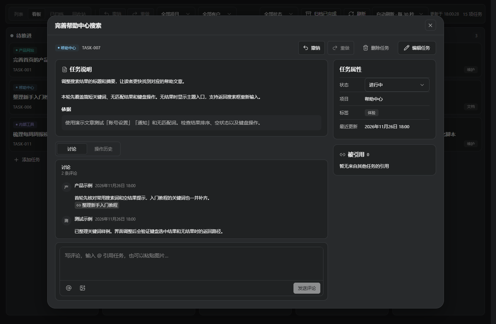

# 推进台

推进台是一个可自建的项目任务看板。网页和 CLI 共用任务、讨论、审阅建议和操作历史。

## 用 Agent 一句话开始

```text
请打开 https://github.com/dsxksss/project-board，按 README 下载本地安装包并安装 $local-project-board 技能，在这台电脑上启动推进台，验证网页和 CLI 可用后打开看板，并告诉我如何创建第一条任务。
```

## 用 Agent 管理看板

日常查进度、补充任务和核对操作历史时，推荐让 Agent 通过 CLI 操作看板。

1. 下载并解压[本地推进台 Skill 安装包](https://raw.githubusercontent.com/dsxksss/project-board/main/downloads/local-project-board-skill.zip)。包内含预构建的网页、CLI 和中文安装说明，需要 Node.js 22.12 或更高版本。
2. 按包内《安装与使用》启动看板并安装技能。本地分发版打开 [127.0.0.1:4390](http://127.0.0.1:4390/)，首次启动是空白看板。
3. 在 Codex 中输入 `$local-project-board 查看当前任务，先只读`。也可以输入 `$local-project-board 把 TASK-001 改为进行中，保留已有说明`。请替换成实际任务编号。

## 界面预览

以下截图使用虚构的项目、任务和评论。

### 分组列表



### 状态看板



### 任务详情



## 本地运行

需要 Node.js 22.12 或更高版本。从仓库根目录运行以下命令。

```sh
npm ci
npm run build
npm start
```

打开 [本地推进台](http://127.0.0.1:4389/)。Windows 用户构建后也可以双击 `start.cmd` 启动。

首次启动会载入演示任务。如果要创建独立的空白工作区，可以在 PowerShell 设置以下变量后启动服务。

```powershell
$env:BOARD_DATA_DIR = Join-Path (Get-Location) 'data/workspace'
$env:BOARD_EMPTY = '1'
$env:BOARD_PORT = '4390'
npm start
```

随后打开 [空白工作区](http://127.0.0.1:4390/)。`BOARD_EMPTY` 只在首次创建数据文件时生效，每份数据目录使用一个服务实例。

## 网页操作

- **列表与看板**。默认显示深色分组列表。支持项目、客户和状态筛选，列表支持折叠分组、调整行高和列宽。看板支持拖动任务和通过「添加任务」新建。看板的「待发布 / 部署」列包含待发布和待部署。网页将原有状态值 `待验收` 显示为「待测试」，CLI 沿用该状态值。
- **预览与快速操作**。悬停任务可查看概要。右键可打开详情、修改状态、复制整行或链接。整行复制包含任务名称、完整说明和状态。
- **任务详情**。点击任务打开弹窗，可直接编辑、发表评论、用 `@` 引用其他任务，或查看被引用记录。评论支持上传或粘贴 PNG、JPEG、GIF 和 WebP，每条最多 4 张，每张最多 4 MB。悬停评论时，右侧会显示删除图标，在任务「操作历史」中撤销可恢复评论及其图片和任务引用。
- **归档**。详情可归档单条已完成任务，筛选栏可归档当前筛选中的所有已完成任务。「已归档」按归档时间分批，每批仍按项目和客户分组，可以打开详情恢复。
- **删除与恢复**。右键任务或打开详情后选择「删除任务」，确认后移入「回收站」，可恢复到原来的视图。回收站不会自动清理。右键回收站任务或打开详情可彻底删除，永久删除后无法撤销。
- **刷新**。页面默认每 30 秒检查更新，工具栏可调整间隔、关闭自动刷新或立即刷新。打开详情或确认弹窗时暂停自动刷新。
- **撤销与重做**。页面顶部支持本次打开页面后的任务修改、归档和删除回退。任务详情的「操作历史」可以核对前后差异并撤销或重做，以服务端记录为准。
- **审阅**。[审阅收件箱](http://127.0.0.1:4389/#/reviews)显示待处理建议和证据。采纳前会核对任务版本，避免覆盖后续修改。

## CLI

CLI 输出 JSON。本地默认连接 `http://127.0.0.1:4389`。下列任务编号来自演示数据。

```powershell
node board.mjs config
node board.mjs task list --project WeMol-DataCore --archive all
node board.mjs task show DC-105
node board.mjs task history DC-105
node board.mjs --help
```

写操作前用 `task show` 读取任务及 `revision`。将下面的 `0` 替换为该任务当前版本，再运行命令。

```powershell
node board.mjs task update DC-105 --stage 待验收 --revision 0
node board.mjs task add --project WeMol-DataCore --title '整理试用反馈'
node board.mjs comment add DC-105 --text '请对照相关任务' --ref DC-102 --author Codex
```

`task list` 默认读取活动任务。`--archive archived` 读取已归档任务，`--archive all` 同时读取两类。私有化部署新增任务需提供 `--product`，省略客户时分到「自己」。

连接非默认实例时可以设置 `BOARD_URL`。连接启用认证的远程实例时，把 `url`、`username` 和 `password` 保存在仓库外的私有 JSON 文件中，并把 `BOARD_PROFILE` 指向该文件。远程连接使用 HTTPS。

```powershell
$env:BOARD_PROFILE = 'C:/path/to/reviewer.json'
node board.mjs task list --archive all
Remove-Item Env:BOARD_PROFILE
```

Windows 的 `board-online.ps1` 会优先读取 `BOARD_PROFILE`，也支持 Codex 用户目录下的 `project-board-access/owner.json`。定时审阅使用具有读取权限的配置。

## 数据与部署

服务默认把任务、审阅建议和评论保存到 `data/board.json`，图片保存到 `data/images/`。备份或迁移时停止服务并复制整份数据目录。可以通过 `BOARD_DATA_DIR` 配置其他目录。

`deploy/` 提供 Linux 的 systemd、Nginx 和 HTTPS 证书续期配置。该模板使用回环后端和独立的读写账号，证书、实际域名或 IP、鉴权文件和运行数据需要由部署方配置。模板中的 `@BOARD_IP@` 用部署地址替换。后端只在本机监听，公开入口由 Nginx 提供。

## 源码目录

| 路径 | 用途 |
| --- | --- |
| `src/main.jsx`、`src/style.css` | 网页入口、任务视图和样式 |
| `src/arc/` | 从 Arc UI 免费 registry 引入并适配的界面组件 |
| `server.mjs` | Web 服务、任务 API 与数据持久化 |
| `board.mjs` | 连接本地或远程实例的 CLI |
| `demo.js` | 首次本地运行的演示任务 |
| `deploy/` | Linux 部署模板 |

Arc UI 源码附有 [MIT 许可](src/arc/LICENSE)。组件来源见 [Arc UI 文档](https://uiarc.dev/docs/ai)。
